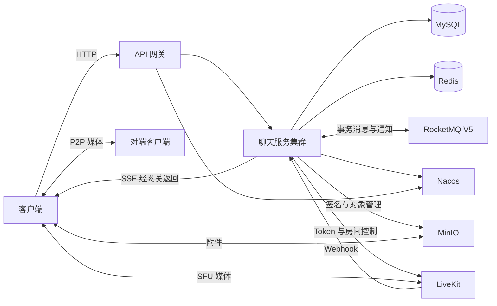

# 项目架构

OpenChat Server 是 OpenChat 的即时通信后端，提供用户与好友、群聊、会话、消息、附件、音视频通话以及客户端版本发布 API。桌面端、Android 端和管理页面是独立项目，本仓库负责服务端实现与接入契约。

[文档首页](README.md) · [首次部署](deployment/start.md)

## 功能范围

| 领域 | 服务端能力 |
| --- | --- |
| 账号 | 邮箱或手机号注册、密码登录、资料与头像、平台和设备绑定、退出登录 |
| 好友 | 申请、回复、同意与拒绝、单向关系、私有备注、标签、联系人排序、黑名单 |
| 会话 | 单聊、群聊、文件助手、列表同步、显式已读确认、置顶、隐藏、清除历史边界、免打扰 |
| 消息 | 文本、图片、视频、文件、音频、语音条、表情、引用、撤回、游标历史和状态补查 |
| 实时通信 | SSE 连接与心跳、MQ 事件分发、大群 LiteTopic、房间活跃合并写入 |
| RTC | 单聊与群聊呼叫、接听设备归属、P2P 协商、SFU 回退、通话恢复、摘要与媒体回调 |
| 附件 | MinIO 上传签名、分片上传、对象校验、附件下载授权和清理 |
| 发布管理 | 管理员登录、安装包上传、发布记录、版本查询和公开下载地址 |

消息枚举、HTTP 接口与客户端界面支持范围是不同层次，客户端应按已经接入的协议开放对应操作。

## 模块

```text
openchat-server/
  pom.xml
  openchat-chat-server/
  openchat-framwork/
    pom.xml
    openchat-common-start/
    openchat-oss-starter/
    openchat-transaction/
    openchat-rtc-server/
  openchat-getway/
  doc/
```

| 模块 | 职责与边界 |
| --- | --- |
| `openchat` | 根 POM 的 artifactId，聚合聊天服务与框架模块，统一管理版本 |
| `openchat-chat-server` | Spring MVC 业务应用，入口 `com.openchat.OpenChatCustomApplication` |
| `openchat-framwork` | 公共模块的 POM 聚合工程 |
| `openchat-common-start` | 公共依赖聚合，没有业务源码目录 |
| `openchat-oss-starter` | MinIO 客户端、对象操作、分片上传与自动配置 |
| `openchat-transaction` | 可靠调用、持久化重试、MQ 生产消费及 LiteTopic 集成 |
| `openchat-rtc-server` | 呼叫领域模型、状态服务、业务端口和 LiveKit 自动配置，供聊天服务引用 |
| `openchat-getway` | 独立 WebFlux API 网关，入口 `com.openchat.OpenChatGateWayApplication` |

网关不属于根 Maven reactor，需独立构建。RTC 模块不独立启动；LiveKit 是单独部署的媒体服务。目录拼写沿用 `framwork`、`getway` 和 `common-start`。

## 运行架构



MySQL 保存业务状态；Redis 保存登录会话、共享缓存、上传会话和协调状态；MQ 驱动消息处理及跨节点通知。SSE 连接属于具体实例，节点级消费组使事件到达持有连接的节点。

HTTP 成功、数据库提交、MQ 确认和客户端收到推送各有自己的完成时点。文件存储与媒体服务也不属于 MySQL 本地事务的一部分。

## 技术栈

| 技术 | 当前源码声明 |
| --- | --- |
| Java | JDK 25 |
| Spring Boot | 4.0.8 |
| Spring Cloud / Alibaba | 2025.1.3 / 2025.1.0.0 |
| MyBatis-Plus / MyBatis | 3.5.17 / 3.5.19 |
| MySQL Connector/J | 9.5.0 |
| Redisson | 4.7.0 |
| RocketMQ V5 Java Client / Starter | 5.2.2 / 2.3.6 |
| MinIO Java SDK | 9.0.3 |
| LiveKit Server SDK | 0.16.0 |
| Springdoc OpenAPI | 3.1.1 |

以上是项目依赖版本，不是外部中间件服务端版本。依赖以[根 POM](../pom.xml)和各模块 POM 为准。

## 代码入口

聊天模块的 Java 包根为 `com.openchat`：

| 包 | 内容 |
| --- | --- |
| `chat` | 消息、房间、会话、群组、处理器与消费者 |
| `user` | 账号、登录、好友、表情与上传业务 |
| `webrtc` | RTC API、数据访问、业务适配和 Webhook |
| `system` | 管理员认证、客户端发布 |
| `common` | 响应、鉴权、异常、缓存、SSE、线程池与工具 |

请求通常按 Controller → Service → DAO/Mapper 处理；消息内容按 `MsgHandlerFactory` 分派到对应处理器。数据库结构见[数据模型](sql/README.md)，协议见[API 约定](api.md)。
