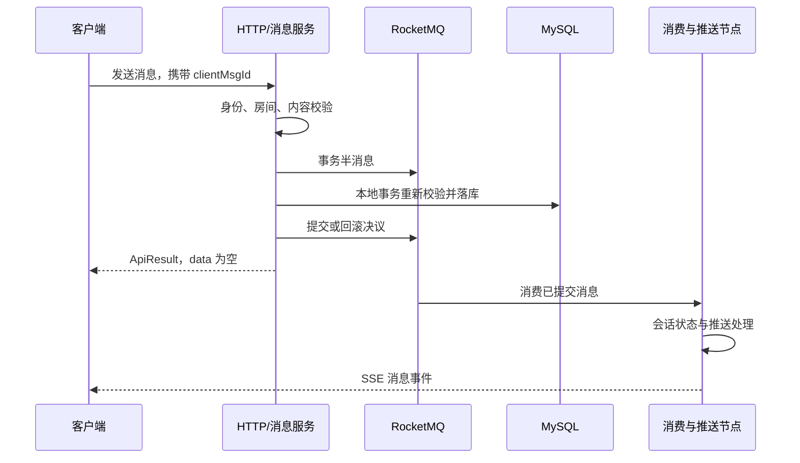

# MQ、SSE 与可靠调用

[文档首页](../README.md) · [基础设施](README.md)

## 消息处理链路

图中 HTTP 返回与消费执行并没有客户端可依赖的严格先后保证。客户端应能处理推送先到、重复到达和断线后补同步。

普通消息的提交依据是本地消息表；回查不确定时返回 UNKNOWN。若本地消息事务加入外层业务事务，MQ 决议等待外层事务最终完成。

## 已提交业务通知

`MQProducer.sendSecureMsg` 通过 `@SecureInvoke` 参与可靠调用：

- 在业务事务内通过 Spring 代理调用时，调用记录与业务一起提交，随后执行发布。
- 不存在数据库事务时直接执行；这种调用不会凭空获得数据库重试记录。
- 通知使用事务消息并带 `openchat_committed_notification=true`，表示发送之前业务已经完成。
- 新聊天消息不能使用该标记，仍需按消息落库结果回查。

MQ 确认失败不能反向回滚已经提交的业务。LiteTopic 使用自己的发布方式，不属于这一普通事务通知链路。

## Topic 与消费组

| Topic | 类型 | 消费组 |
| --- | --- | --- |
| `chat_send_msg` | TRANSACTION | `chat_send_msg_group`，聊天处理实例共享 |
| `sse_push` | TRANSACTION | `sse_push_group-<chatnode>` |
| `rtc_sse_push` | TRANSACTION | `rtc_sse_push_group-<chatnode>` |
| `sse_push_lite` | Lite 父 Topic | Lite 客户端配置的消费组加节点后缀 |

`rocketmq.lite.chatnode` 必须在节点间唯一且稳定。普通 SSE/RTC 按节点独立消费，收到事件后只投递到本节点持有的连接。

Topic、队列、消费组、权限以及 Lite 能力由目标 MQ 环境准备。应用连接 V5 Proxy gRPC，不通过普通 NameServer 属性创建客户端，也不自动执行 Broker 管理操作。

普通消费者由官方 `@RocketMQMessageListener` 和 Starter 管理。项目的连接配置适配器在容器初始化前同步 TLS 和超时参数；初始化顺序适配保留官方注册与生命周期。

## 可靠调用记录

`secure_invoke_record` 保存调用快照、状态、下次执行时间、重试次数和失败原因。

| 状态 | 值 | 含义 |
| --- | --- | --- |
| WAIT | 1 | 等待执行 |
| FAIL | 2 | 已达到失败终态 |
| RUNNING | 3 | 已领取执行 |

执行节点通过条件更新领取任务，租约为 5 分钟。成功删除和失败更新同时匹配记录 ID、状态及本次租约时间；超时执行者不能覆盖后续领取者的结果。

注解默认最多重试 3 次，资源清理等特定调用可配置为 10 次。重试耗尽保留失败记录，需结合业务核查。节点中断或确认丢失仍可能导致重复副作用，业务接口必须遵守既有幂等条件。

## 大群与 LiteTopic

群成员达到 `openchat.chat.push.large-group-member-threshold` 后按大群方式路由，默认阈值为 200。提升为大群后不会因成员退出自动降回普通群。

Lite 客户端按节点维护房间订阅。未就绪或订阅未完成时走普通推送回退；实际发送异常仍交给上游处理，不能报告假成功。

订阅建立与历史补同步配合，减少上线和订阅窗口中的消息缺口。无论使用哪条推送路径，消息数据库仍是历史查询来源。

## SSE 与连接归属

SSE 连接表是实例内状态，不能由它推断集群所有用户的连接。MQ 事件在各节点消费后路由到本地连接，登录变更通知和心跳共同处理失效会话。

SSE 推送由有界独立执行器处理，慢连接不能无限占用业务队列。连接断开不删除数据库消息；重连客户端根据游标和消息状态补齐数据。

## 正常停机

`MqConsumerShutdown` 在应用关闭时枚举已创建的 MQ 容器，并行调用正常停止入口。Lite 消费者停止后标记不可用，发送端保留到后续销毁，以供尚在执行的普通消费回调使用。

停机等待仍取决于 SDK 长轮询、在途消费和 ACK，不保证固定秒数结束。强制终止、确认丢失和节点故障按 MQ 重投及业务状态恢复处理。

## 验证范围

至少验证重复投递、乱序通知、本地提交后进程中断、跨实例回查、两个节点分别持有 SSE、领取租约到期以及正常停机。单元测试和 Mock 不替代上述真实环境验证，也不证明 exactly-once 或全局顺序。

源码入口：[MQProducer](../../openchat-framwork/openchat-transaction/src/main/java/com/openchat/transaction/service/MQProducer.java)、[可靠调用 DAO](../../openchat-framwork/openchat-transaction/src/main/java/com/openchat/transaction/dao/SecureInvokeRecordDao.java)、[消息消费者](../../openchat-chat-server/src/main/java/com/openchat/chat/consumer/MsgSendConsumer.java)。
