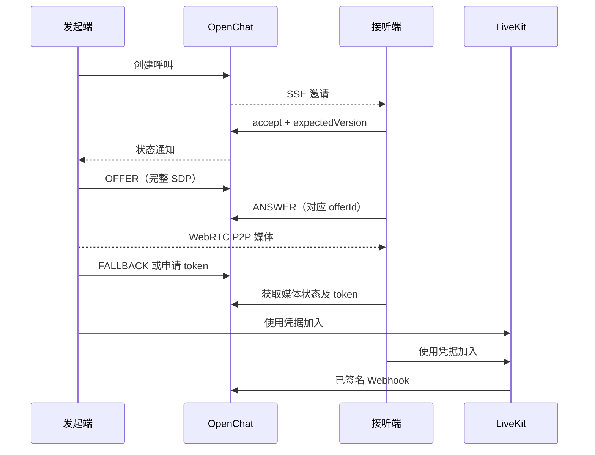

# 音视频通话

OpenChat 管理呼叫权限、邀请、接听设备、通话状态与信令。媒体由客户端 WebRTC P2P 或 LiveKit SFU 传输，HTTP、MQ 和 SSE 不承载音视频数据。

[文档首页](../README.md) · [鉴权与响应](../api.md) · [环境配置](../deployment/configuration.md)

## 模块与存储

`openchat-rtc-server` 提供领域模型、呼叫服务、业务端口和 LiveKit 自动配置。聊天应用的 `com.openchat.webrtc` 实现 Controller、权限、持久化、通知、媒体与回调适配。

| 存储 | 内容 |
| --- | --- |
| `rtc_call` | 呼叫、房间、发起人、单聊被叫、整体状态、版本、时间与摘要消息标识 |
| `rtc_group_call_member` | 群房间内的当前参与记录，以 `(room_id, uid)` 标识 |
| `rtc_group_call_member_history` | 某次群通话的参与记录，以 `(call_id, uid)` 标识，含独立成员版本 |
| `rtc_media_session` | P2P/SFU 传输选择、Offer、Answer 与媒体版本 |
| `rtc_webhook_event` | 验签后的 LiveKit 事件及处理依据 |
| Redis | 摄像头状态、关闭标记、群视频席位及其他协调数据 |

群呼叫的 `callee_uid` 为空，参与状态从成员表取得；单聊以主叫、被叫及呼叫状态共同决定参与视图。设备映射保存在呼叫数据中，但不向客户端公开原始设备标识。

## 对外状态

当前全局 Jackson 配置启用枚举序号输出。`RtcCallState` 和 `RtcMediaMode` 没有 `@JsonValue`；其他字段按各自声明输出：

| 字段 | HTTP 呼叫视图中的值 |
| --- | --- |
| `state` | `0` RINGING、`1` ACCEPTED、`2` CONNECTED、`3` REJECTED、`4` CANCELED、`5` ENDED、`6` EXPIRED |
| `mediaMode` | `0` AUDIO、`1` VIDEO |
| `participants[].state` | `1` INVITED、`2` ACCEPTED、`3` REJECTED、`4` EXPIRED、`5` LEFT |
| `deviceOwnership` | `"UNASSIGNED"`、`"CURRENT_DEVICE"`、`"OTHER_DEVICE"`、`"UNKNOWN"` |
| 媒体 `transport` | `"P2P"` 或 `"SFU"` |
| 信令 `kind` | `"OFFER"`、`"ANSWER"`、`"FALLBACK"`、`"CAMERA"` |

不要根据枚举 Java 名称统一假定 JSON 类型。通话摘要消息的 `rtcCall.mediaMode`、`rtcCall.state` 由代码显式写入名称字符串，与上表中的呼叫视图字段不同。

`callId` 是字符串；UID、roomId、summaryMessageId 等 Long 标识也是字符串。呼叫与成员的 `version` 是整数，Long 类型的 `durationSeconds` 和摄像头版本按全局配置序列化为字符串。

## 呼叫接口

所有下列路径以 `/capi/rtc` 为前缀，并使用当前用户的 Bearer token、平台和设备请求头。

| 方法与路径 | 用途 |
| --- | --- |
| `POST /calls` | 发起通话或进入群通话流程 |
| `GET /calls/{callId}` | 获取本人有权访问的通话快照 |
| `GET /calls/active` | 查询本人未结束的参与记录，含响铃和群通话 |
| `GET /calls/ongoing` | 查询本人已接听或已连接的单聊，返回通话及对端名称 |
| `GET /rooms/{roomId}/active` | 有效群成员发现该群通话，无通话返回 `data:null` |
| `POST /calls/{callId}/accept` | 单聊接听，或当前群成员加入群通话 |
| `POST /calls/{callId}/reject` | 拒绝邀请 |
| `POST /calls/{callId}/cancel` | 取消呼叫中的邀请 |
| `POST /calls/{callId}/expire` | 按服务端截止时间处理未接听邀请 |
| `POST /calls/{callId}/hangup` | 挂断通话 |
| `POST /calls/{callId}/leave` | 离开本人参与的通话 |
| `POST /calls/{callId}/reconnect` | 用户确认后恢复原单聊，复用 callId 并使用 SFU |
| `POST /calls/{callId}/token` | 切换至 SFU 并申请 LiveKit 加入凭据 |
| `GET /calls/{callId}/media` | 读取媒体协商快照 |
| `POST /calls/{callId}/media` | 提交 SDP、SFU 回退或摄像头状态 |
| `POST /calls/{callId}/video` | 获取、续期或释放群视频席位 |

创建请求：

```json
{
  "roomId": "123",
  "mediaMode": 1,
  "clientRequestId": "dial-request-1",
  "participantUids": ["456"],
  "replaceCallIds": []
}
```

群邀请范围由 `participantUids` 指定；未指定时服务会选择全体群成员。身份、好友/群关系和房间类型由后端校验，不接受客户端自行声明通话参与权限。

客户端呼出前查询 `/calls/active`。只有用户明确同意结束的通话才放进 `replaceCallIds`，最多 100 项；缺省或空列表不授权结束已有通话。服务端重新校验通话归属与状态，不把客户端快照当作写入事实。

接听、拒绝、取消、过期、挂断和离开使用操作请求：

```json
{
  "clientRequestId": "action-request-1",
  "expectedVersion": 1
}
```

单聊操作按呼叫版本协调。群成员操作使用本人 `participants` 项的成员版本，不能直接套用整体呼叫版本；尚无本人参与记录时，加入流程使用初始预期版本 `1`。冲突后读取最新快照，再判断是否仍需操作。

## 邀请与群通话

邀请超时为 60 秒，表示未接听邀请的有效期，不是通话最长持续时间。客户端可在截止后请求 `/expire`，服务端核对实际截止时间和最新成员状态。

同一群房间的活动呼叫由唯一性约束和服务端状态协调。有效群成员可以先查询 `/rooms/{roomId}/active`，再调用 `/accept` 加入，无须预先收到邀请。

群参与者具有独立状态和版本。退出后本人进入 LEFT，其他已加入成员继续通话；最后一个已加入成员离开时结束群通话，尚未响应的邀请不会让空通话永久保持活动。已退出成员再次加入时重新校验当前群关系和设备。

群成员加入、退出与其他人的动作可能发生在不同节点。客户端按成员版本和完整快照更新界面，不以单个客户端的本地人数决定终态。

## 接听设备

发起或接听后，服务端将本人参与记录绑定到已鉴权的平台和设备。HTTP 只返回当前请求设备的归属：

- `UNASSIGNED`：本人仍处于待接听状态，尚无设备归属。
- `CURRENT_DEVICE`：本人参与记录属于当前设备。
- `OTHER_DEVICE`：本人已由其他设备参与。
- `UNKNOWN`：无法从当前参与记录确定归属。

未接听邀请可以通知多个在线端；只有取得接听归属的设备能继续媒体和受限制的结束操作。另一设备不能仅凭相同 UID 获取媒体凭据或接管通话。

`/calls/ongoing` 是查询入口，不会因客户端打开页面而自动重连。用户确认后调用 `/reconnect`；恢复时若设备身份缺失或不匹配，服务端结束该单聊并返回相应失败，避免另一设备接管。群成员正常退出后，可在重新加入时建立新的设备归属。

## P2P 与 SFU



启用 P2P 时，单聊可由主叫提交 Offer、被叫提交 Answer。信令采用 non-trickle 方式，SDP 包含本次 ICE 候选；此接口没有逐条候选推送协议。

`clientRequestId` 和 `offerId` 按 `[A-Za-z0-9_-]{1,128}` 校验，SDP 最长 60000 字符。Answer 必须对应当前 Offer，媒体状态与版本由服务端控制。

群通话使用 SFU。单聊发生回退或请求 `/token` 后进入 SFU，该通话不再切回 P2P。Token 仅对当前允许参与、已接听/已连接且设备归属匹配的用户签发。

媒体凭据包含目标房间和用户权限，不能当作普通聊天 token 使用。LiveKit URL、密钥、有效期及网络要求见[配置说明](../deployment/configuration.md)。

## 视频与摄像头

群视频席位由 Redis Lua 原子分配，上限 9 个，租期 90 秒。`POST /video` 使用 `{ "enabled": true }` 申请或续期，`false` 释放。未获得席位时不能假定当前凭据已允许发布摄像头视频。

摄像头开关通过 `CAMERA` 信令提交 `enabled` 与 `expectedCameraVersion`，独立于呼叫整体版本。状态存于 Redis，采用条件更新并设置一天有效期。

视频通话结束会登记可靠清理，写入关闭标记以拒绝迟到请求重新创建摄像头状态。客户端切换状态后仍需按服务端媒体快照更新，不能只改变本地按钮。

## LiveKit 回调

```text
POST /capi/livekit/callback
Content-Type: application/webhook+json
Authorization: <LiveKit 签名>
```

网关必须保留原始 UTF-8 正文。后端使用 LiveKit SDK 核对签名、签发者、有效期和正文 SHA-256；回调不走普通聊天 JWT。

事件先按 LiveKit event id 去重，并核对房间、参与用户和呼叫状态。事件落库、版本领取和呼叫状态更新在事务内完成；已提交事件或确认的重复请求返回 204。不处理的事件类型、非项目房间和未知呼叫/参与者直接确认但不写入；格式错误、验签失败和事务失败按对应错误返回。

`CONNECTED` 的判定使用同一 LiveKit 房间实例内不同 UID 的实际在线区间交集，不把一方加入当作双方已连通。乱序事件按时间和参与实例重建区间，同秒先处理离开再处理加入，避免产生虚假的交集。

单个 `participant_left` 事件不直接结束呼叫。`room_finished` 还需排除更新的房间实例并查询实际 LiveKit 房间是否已关闭，再决定终态和后续通知。

P2P 媒体没有对应 LiveKit 事件，服务端不能由此观测真实直连媒体区间。通话没有 `connectedAt` 时，摘要时长按已接听时间回退计算，不能把它当作精确媒体质量统计。

## 摘要与恢复边界

终态会生成 type 11 通话摘要，记录 callId、媒体类型、终态、结束原因和时长。摘要沿用普通消息存储、推送与历史接口，通过呼叫中的摘要标识协调重复处理；客户端不能自行发送该消息类型。

SSE 或进程断开不等于参与者已完成离开。网络恢复后查询通话和媒体快照；不能仅凭本地断线清空服务端状态，也不能假定群成员一定会因客户端进程退出立即移除。

首次部署应覆盖多端同时接听、成员独立加入/退出、重复与乱序回调、节点中断、P2P 回退、设备不匹配恢复以及挂断竞争。测试类与执行入口见[开发与验证](../development.md)，单元测试不能替代真实媒体与多实例联调。

## 源码入口

- [RTC Controller](../../openchat-chat-server/src/main/java/com/openchat/webrtc/controller/RtcController.java)
- [呼叫视图与设备投影](../../openchat-framwork/openchat-rtc-server/src/main/java/com/openchat/rtc/domain/vo/RtcCallView.java)
- [群呼叫服务](../../openchat-framwork/openchat-rtc-server/src/main/java/com/openchat/rtc/service/RtcGroupCallService.java)
- [媒体服务](../../openchat-chat-server/src/main/java/com/openchat/webrtc/service/RtcMediaService.java)
- [恢复服务](../../openchat-chat-server/src/main/java/com/openchat/webrtc/service/RtcRecoveryService.java)
- [回调事务处理](../../openchat-chat-server/src/main/java/com/openchat/webrtc/service/RtcWebhookService.java)
